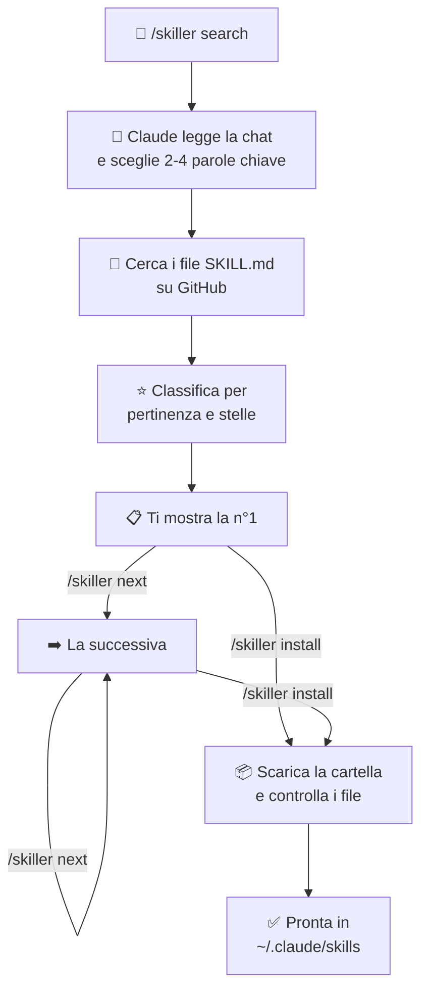

<div align="center">



<br>

**Trova su GitHub la skill per Claude Code più votata per quello che stai facendo, e la installa con un comando.**

<br>


[Cos'è](#-cosè) · [Installa con un prompt](#-installa-con-un-prompt) · [Comandi](#-comandi) · [Come funziona](#-come-funziona) · [Sicurezza](#-sicurezza)

</div>

---

## ✨ Cos'è

Esistono migliaia di skill per Claude Code sparse su GitHub, ma trovare quella giusta vuol dire cercare, aprire repository e confrontare stelle a mano.

**skiller lo fa al posto tuo.** Legge il tema della chat in cui sei, cerca su GitHub le skill che c'entrano, le mette in classifica e ti mostra la migliore. Ti piace? `/skiller install`. Non ti convince? `/skiller next`.

<div align="center">

</div>

<table>
<tr>
<td width="33%" valign="top">

### 🎯 Capisce il contesto
Non devi scrivere cosa cerchi: Claude ricava le parole chiave dalla sessione. Se vuoi, puoi aggiungerne tu.

</td>
<td width="33%" valign="top">

### ⭐ Solo le migliori
Prima le skill più pertinenti al tema, poi quelle con più stelle. Salta quelle che hai già installato.

</td>
<td width="33%" valign="top">

### 🪶 Pochissimi token
Il lavoro pesante lo fa uno script Node. Claude legge solo 4 righe di risultato, non pagine di ricerca.

</td>
</tr>
</table>

---

## 🚀 Installa con un prompt

Il modo più semplice: apri **Claude Code** e incolla questo messaggio.

```text
Installa la skill skiller: clona https://github.com/MasterBudz/skiller nella cartella
~/.claude/skills/skiller, poi controlla che Node e la GitHub CLI (gh) siano installati
e che gh sia collegato al mio account. Se manca qualcosa, dimmi come sistemarlo.
```

Claude scarica la skill, controlla i requisiti e ti dice se manca qualcosa. Da quel momento `/skiller` è disponibile (se non lo vedi, apri una nuova sessione).

<details>
<summary><b>Preferisci il terminale?</b></summary>

<br>

**macOS / Linux / Git Bash**

```bash
git clone https://github.com/MasterBudz/skiller ~/.claude/skills/skiller
```

**Windows PowerShell**

```powershell
git clone https://github.com/MasterBudz/skiller "$env:USERPROFILE\.claude\skills\skiller"
```

Per aggiornarla in futuro: `git -C ~/.claude/skills/skiller pull`

</details>

### Requisiti

| | Cosa serve | Perché |
|---|---|---|
| 🟢 | [Node.js](https://nodejs.org) 18 o superiore | esegue lo script di ricerca |
| 🐙 | [GitHub CLI](https://cli.github.com) con `gh auth login` fatto | la ricerca nel codice di GitHub richiede un account |
| 🤖 | [Claude Code](https://claude.com/claude-code) | dove gira la skill |

---

## 🕹️ Comandi

| Comando | Cosa fa |
|---|---|
| `/skiller` | Mostra l'elenco dei comandi |
| `/skiller search` | Trova la skill migliore per il tema della chat |
| `/skiller search stripe` | Come sopra, ma con le parole chiave che scegli tu |
| `/skiller next` | Passa alla prossima della classifica (fino a 25) |
| `/skiller install` | Installa quella mostrata in `~/.claude/skills/` |

---

## ⚙️ Come funziona



**La classifica:** ogni risultato prende punti se le parole chiave compaiono nel nome della skill (vale doppio) o nel suo percorso. A parità di punti vince chi ha più stelle. Le skill di esempio, di test e quelle già installate vengono scartate.

**I token:** le istruzioni della skill sono poche righe e Claude la avvia solo quando scrivi `/skiller`, mai da solo. Ricerca, classifica e download li fa `skiller.mjs`, quindi nella chat entra solo il risultato finale.

---

## 🛡️ Sicurezza

Una skill è codice scritto da altri, quindi skiller fa attenzione:

- **Installa solo quando lo chiedi tu.** Prima vedi nome, stelle, descrizione e il link per guardarla su GitHub.
- **Controlla i file scaricati** e ti avvisa con ⚠ se trova comandi rischiosi, come script scaricati ed eseguiti da internet, `Invoke-Expression`, cancellazioni di massa o codice nascosto in base64.
- **Non sovrascrive niente.** Se una skill con lo stesso nome esiste già, si ferma.
- **Si ferma sulle cartelle enormi** (più di 150 file).

> [!TIP]
> Prima di installare, apri il link "Dove" e dai un'occhiata al `SKILL.md`: bastano dieci secondi.

---

## 📁 Cosa c'è dentro

```text
skiller/
├── SKILL.md      # le istruzioni per Claude (poche righe)
├── skiller.mjs   # ricerca, classifica, next e install
└── assets/       # la grafica di questa pagina
```

---

<div align="center">

Fatto con 💜 per chi usa Claude Code tutti i giorni · Licenza [MIT](LICENSE)

</div>
